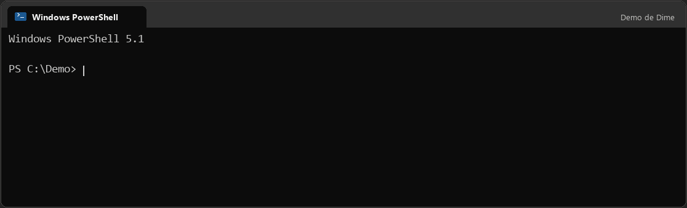

# Dime

Dime es un asistente local que convierte peticiones en español en sugerencias de **Bash** y **expresiones regulares de Python**. El modelo v6, de **12,7 millones de parámetros**, se entrenó desde cero con PyTorch. El repositorio incluye los pesos de inferencia (**50,8 MB**) y el tokenizador.



La animación muestra salidas capturadas en Windows PowerShell 5.1 con una ruta de ejemplo. Dime muestra el resultado en texto para que lo revises y copies.

## Instalación

Necesitas **Python 3.11 o posterior** y un equipo compatible con PyTorch. Clona el repositorio o descarga el ZIP de GitHub y abre una terminal en la carpeta donde está `pyproject.toml`.

Si ya tienes [pipx](https://pipx.pypa.io/stable/how-to/install-pipx.html) configurado, instala Dime desde esa carpeta:

```sh
pipx install .
```

<details>
<summary>Cómo instalar pipx en Windows</summary>

```powershell
py -m pip install --user pipx
py -m pipx ensurepath
```

Abre PowerShell de nuevo y ejecuta `pipx install .` en la carpeta del repositorio.

</details>

También puedes ejecutar `python -m pip install .` en un entorno de Python que ya uses. La instalación descarga las dependencias que falten. Después, la inferencia funciona localmente con el modelo incluido.

## Uso

**Consulta Bash** · Cuenta las líneas de un archivo.

```powershell
dime "Cuenta las líneas de notas.txt"
```

Dime devuelve `wc -l < 'notas.txt'`.

**Consulta regex** · Genera un patrón para una cadena de exactamente tres dígitos ASCII.

```powershell
dime --tarea regex "Necesito una regex para exactamente tres cifras ASCII."
```

Dime devuelve `[0-9]{3}`.

**Sesión interactiva** · Escribe `dime` para hacer varias consultas con el modelo ya cargado. Escribe `:quit` para cerrar. Usa `dime --tarea regex` para una sesión de expresiones regulares.

Bash es la tarea predeterminada. Dime reconoce peticiones como leer un archivo, contar líneas, filtrar texto, ordenar y buscar archivos de forma recursiva. Las sugerencias están escritas para Bash/GNU Linux, que puedes usar desde WSL en Windows. Las regex están pensadas para `re.fullmatch` con `re.ASCII`. Usa `--dispositivo cpu` para seleccionar CPU y `dime --help` para ver las opciones.

## Arquitectura del modelo

El modelo es un **Transformer causal de tipo LLaMA** implementado en PyTorch. Predice el siguiente token de la respuesta a partir de la petición y de los tokens generados hasta ese momento.

| Componente | Configuración |
|---|---|
| Parámetros entrenables | 12.691.584 |
| Capas y dimensión oculta | 8 bloques, dimensión 384 |
| Atención | 6 cabezas de consulta y 2 de clave/valor (GQA) |
| Componentes del bloque | RoPE, RMSNorm y SwiGLU |
| Tokenización | 256 bytes UTF-8 y 10 tokens de control |
| Contexto máximo | 512 tokens |
| Pesos de inferencia | 50,8 MB |

La implementación del modelo está en [model.py](dime_terminal_cli/model.py) y el comando `dime` está en [cli.py](dime_terminal_cli/cli.py).

## Entrenamiento desde cero

La corrida comenzó con **pesos inicializados al azar**. El corpus reunió **94.943 ejemplos sintéticos de 47 familias**. Se incluyeron contrastes sobre un mismo argumento para distinguir operaciones parecidas, como listar todos los archivos, filtrar por extensión y contar los resultados.

El muestreo asignó un **50 % a Bash, 40 % a regex y 10 % a ejercicios de copia literal**. La pérdida supervisó los tokens de la respuesta y su token de fin. El entrenamiento completó **4.451 actualizaciones**, con un lote de 64 y dos pasos de acumulación de gradiente.

Para elegir los pesos se usaron **131 peticiones de validación** que cubren las 47 familias. Se seleccionó el **checkpoint del paso 3.400**, según la exactitud media por familia y la pérdida de validación como desempate.

## Evaluación y límites

El checkpoint congelado se evaluó con **719 peticiones sintéticas reservadas**. Una respuesta contaba como acierto si coincidía exactamente con la referencia y terminaba con el token de fin.

| Evaluación reservada | Respuestas exactas |
|---|---:|
| Copia con argumentos nuevos | 216/226 (95,58 %) |
| Interpretación con redacción nueva y casos conocidos | 267/267 (100 %) |
| Redacción y argumentos nuevos | 217/226 (96,02 %) |
| **Total** | **700/719 (97,36 %)** |

En el test, 18 desacuerdos se debieron a que el modelo alteró el mismo nombre de archivo y uno a que interpretó mal una cantidad. Con peticiones libres también puede ignorar restricciones que quedaron fuera del entrenamiento, como buscar únicamente en el primer nivel de una carpeta. Revisa los argumentos y las opciones antes de usar una sugerencia.

El **percentil 95 del tiempo hasta el primer token fue de 15,72 ms** en 50 mediciones con una RTX 3080 Laptop, CUDA/BF16 y el modelo cargado y caliente. Una consulta individual también incluye el tiempo de arrancar Python y cargar el modelo.

Consulta la [ficha del modelo](MODEL_CARD.md), los [resultados agregados](evaluation.json) y las [huellas de los pesos y el tokenizador](SHA256SUMS).
